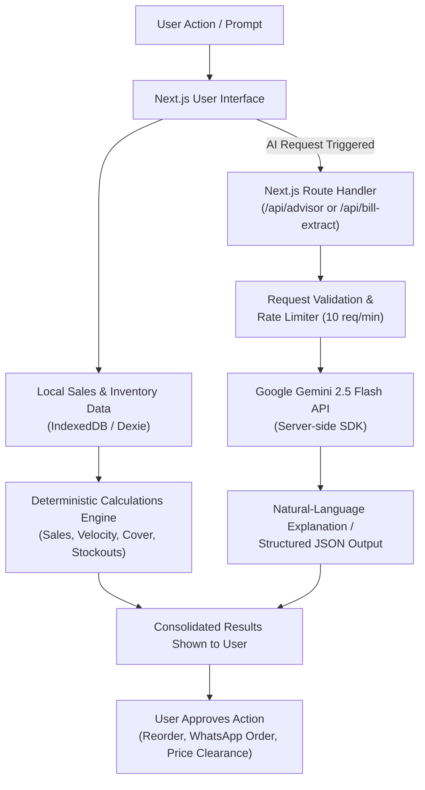
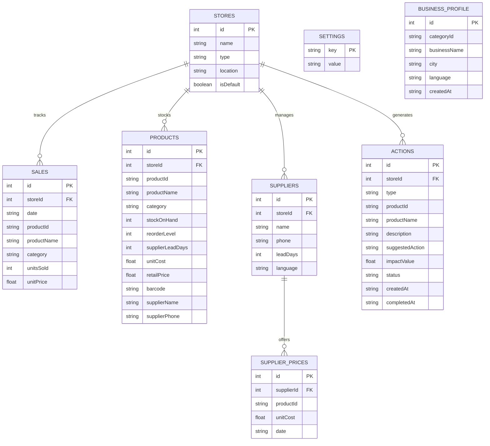

# BizCopilot 🇮🇳

[](https://nextjs.org/)
[](https://www.typescriptlang.org/)
[](https://tailwindcss.com/)
[](https://ai.google.dev/)
[](https://dexie.org/)
[](https://biz-phi-beige.vercel.app)
[](LICENSE)

## AI Sales & Inventory Advisor for Small Shop Owners in India

- 🌐 **Live Application:** [https://biz-phi-beige.vercel.app](https://biz-phi-beige.vercel.app)
- 📦 **GitHub Repository:** [https://github.com/dvkusuma6-1522/bizcopilot-clean](https://github.com/dvkusuma6-1522/bizcopilot-clean)
- **Product Category:** AI-assisted retail analytics, inventory intelligence, and daily shop operations
- **Primary Users:** Kirana stores, pharmacies, apparel/footwear shops, perishable-goods retailers, restaurants/cafes, hardware stores, electronics shops, distributors, salons, and stationery shops across India.
- **Trilingual Support:** **ಕನ್ನಡ (Kannada)**, **हिन्दी (Hindi)**, and **English** (native scripts with instant toggle).

BizCopilot helps small shop owners turn everyday sales and inventory numbers into practical actions: detect sales drops before month end, prevent stockouts before supplier delivery, liberate cash trapped in dead stock, and ask an AI advisor for explanations in familiar language.

> **Core Principle — Facts First:** Deterministic application logic calculates all business metrics (days of cover, reorder quantities, dead stock values). Google Gemini 2.5 Flash explains those metrics and helps owners reason about them; AI never invents or silently replaces underlying numbers. Every alert provides transparent mathematical evidence.

------------------------------------------------------------------------

## Table of Contents

-   [Overview](#overview)
-   [Problem and Solution](#problem-and-solution)
-   [Key Features](#key-features)
-   [Application Walkthrough](#application-walkthrough)
-   [AI Features and Architecture](#ai-features-and-architecture)
    -   [API Reference](#api-reference)
-   [How AI and Business Logic Work Together](#how-ai-and-business-logic-work-together)
-   [Technical Stack](#technical-stack)
-   [System Architecture](#system-architecture)
    -   [Data Schema](#data-schema)
-   [Data Flow](#data-flow)
-   [Privacy and Security](#privacy-and-security)
-   [Languages and Accessibility](#languages-and-accessibility)
-   [Demo Data and Metrics](#demo-data-and-metrics)
-   [Environment Variables](#environment-variables)
-   [Local Setup](#local-setup)
-   [Testing and Build Verification](#testing-and-build-verification)
-   [Deployment to Vercel](#deployment-to-vercel)
-   [Known Limitations and Honest Scope](#known-limitations-and-honest-scope)
-   [Project Structure](#project-structure)
-   [Roadmap](#roadmap)
-   [Contributing](#contributing)
-   [License](#license)
-   [Project Links](#project-links)

------------------------------------------------------------------------

## Overview

Small retailers often make purchasing decisions using memory,
handwritten records, spreadsheets, and intuition. BizCopilot is designed
to make those decisions easier by bringing sales summaries, inventory
status, stockout warnings, and recommended actions into one interface.

The dashboard includes an overview of store performance, sales
analytics, inventory intelligence, AI recommendations, and an AI
Copilot. The sample store shown in the demo is **FreshMart Grocery**,
located in Indiranagar, Bengaluru.

The application is designed around a **local-first** data model. Sales
and inventory calculations can run in the browser without requiring a
cloud database or an AI API key. Optional Google Gemini integration adds
natural-language explanations and image-based supplier-bill extraction
through server-side API routes.

### Goals

-   Make inventory decisions understandable to non-technical shop
    owners.
-   Highlight urgent replenishment needs before shelves run empty.
-   Explain recommendations with visible business calculations.
-   Reduce manual work when entering sales and stock updates.
-   Support Indian retail contexts and regional languages.
-   Keep raw transaction data local wherever possible.
-   Retain a deterministic fallback when the AI provider is unavailable.

------------------------------------------------------------------------

## Problem and Solution

### The problem

Small shops may struggle to answer practical questions quickly:

-   Which products are selling fastest?
-   How many days will the current stock last?
-   Which items may run out before a supplier can deliver?
-   How much stock should be ordered?
-   Which products are sitting unsold?
-   What should the owner do today versus later this week?
-   Can a supplier bill be entered without typing every line manually?

These decisions affect customer satisfaction, working capital, and
avoidable lost sales.

### The solution

BizCopilot combines three layers:

1.  **Retail data layer** --- sales transactions and inventory records.
2.  **Deterministic analytics layer** --- repeatable calculations for
    sales, stock cover, stockout risk, and replenishment
    recommendations.
3.  **AI assistance layer** --- conversational explanations and selected
    document extraction based on limited, relevant inputs.

The application presents results as dashboard metrics, alerts,
explanations, and actions rather than requiring the owner to interpret
raw spreadsheets.

------------------------------------------------------------------------

## Key Features

### 1. Store Performance Overview

The dashboard summarizes store activity, including:

-   Total shop sales for the selected period.
-   Total items sold.
-   Products at stockout risk.
-   Value of unsold or idle stock.
-   Comparison with a previous reporting period.
-   Urgent actions surfaced in the **Act Today** section.

The numbers depend on the selected reporting period and the currently
loaded dataset.

### 2. Sales Analytics

Sales analytics help users understand performance over a selected
period, identify product demand patterns, and compare current results
with a previous period. The exact charts and calculations should be
verified against the current application build.

### 3. Inventory Intelligence

Inventory intelligence is intended to help answer:

-   How many units are available?
-   How quickly is an item selling?
-   Approximately how many days of stock remain?
-   How long does supplier replenishment take?
-   Is a reorder action needed now?

A typical stock-cover calculation is:

`days_of_cover = stock_on_hand / average_daily_demand`

This is meaningful when average daily demand is greater than zero. The
application should handle zero or missing demand safely.

### 4. Reorder and Stockout Recommendations

The deterministic engine can estimate a replenishment quantity from
demand, supplier lead time, a safety buffer, and available stock.

A documented example formula is:

`reorder_quantity = max(0, ceil(daily_demand × (lead_time_days + buffer_days) − stock_on_hand))`

Where:

-   `daily_demand` is the estimated average number of units sold per
    day.
-   `lead_time_days` is the expected supplier delivery time.
-   `buffer_days` is the additional stock-cover target.
-   `stock_on_hand` is the current available inventory.
-   `ceil` rounds a positive requirement up to a whole unit.

**Illustrative example:** If daily demand is 4 units, supplier lead time
is 5 days, the buffer is 7 days, and stock on hand is 10 units:

`ceil(4 × (5 + 7) − 10) = 38 units`

The example is illustrative, not a universal ordering rule. Shop owners
should account for pack sizes, minimum order quantities, expiry dates,
cash flow, and supplier constraints before placing an order.

### 5. Act Today

The Act Today area prioritizes urgent operational issues. An item can
show available stock, estimated demand, days of cover, supplier delivery
time, a recommended action, and an explanation of how the recommendation
was calculated.

Where available, the interface may provide actions such as inspecting
the issue, opening a supplier order message in WhatsApp, marking work
done, or dismissing an item. These actions should be confirmed in the
currently deployed build.

### 6. AI Recommendations

AI Recommendations present actionable suggestions derived from the
store's sales and inventory context. Numeric recommendations should be
anchored to deterministic metrics so the same inputs produce the same
quantities.

### 7. AI Copilot / Advisor

The AI Advisor is intended to let a shop owner ask questions in natural
language, such as:

-   "Which products need attention today?"
-   "Why is this item at risk of running out?"
-   "What should I prepare for a busy festival period?"
-   "Explain this sales trend in simple language."

The supplied project specification describes a streaming `/api/advisor`
endpoint that receives aggregated metric summaries rather than raw sales
transaction history. When Gemini is not configured or is unavailable,
the application is intended to fall back to deterministic, rule-based
advice.

### 8. Supplier Bill Scanner

The supplied specification describes an `/api/bill-extract` route that
accepts a supplier-bill image and uses a multimodal Gemini model to
extract structured line items. Extracted results should be validated
before being offered for entry into inventory.

OCR can make mistakes. Users should review item names, quantities,
prices, and totals before saving extracted data.

### 9. Fast Daily Entry

The described product supports quick entry workflows intended for
shop-floor use:

-   On-screen numeric keypad with `0–9`, `+1`, `+5`, and `+10`.
-   Barcode scanning for EAN-13 / UPC formats.
-   Voice entry in Kannada, Hindi, and Indian English.
-   Deterministic parsing of quantities and item names.
-   A short undo window for reversible transactions.

These features are part of the supplied project specification; verify
their availability and browser/device compatibility in the build being
demonstrated.

### 10. Festival and Peak-Day Calendar

The project specification describes a 2026--2027 Indian retail calendar
covering events and seasonal periods such as Ugadi, Diwali, Sankranti,
Ganesh Chaturthi, monsoon, and wedding season. Calendar-based
stock-cover alerts can help owners plan for demand changes.

Calendar events are planning signals, not guarantees of increased
demand. Recommendations should be checked against the shop's own history
and local customer patterns.

### 11. Data Import

The dashboard includes a data-import area. The supplied specification
describes CSV and Excel import workflows. Imported files should be
validated for required columns, valid quantities and dates, duplicate
records, and product matching before affecting business calculations.

------------------------------------------------------------------------

## Application Walkthrough

A typical workflow is:

1.  Open the dashboard and review the selected reporting period.
2.  Check store-level sales, items sold, stockout risks, and idle stock.
3.  Open **Act Today** to review urgent inventory issues.
4.  Inspect an item's stock, demand, lead time, and calculation
    explanation.
5.  Review the suggested reorder quantity.
6.  If the feature is enabled, open the prepared WhatsApp message and
    verify the product name and quantity before sending it.
7.  Use Sales Analytics or Inventory Intelligence to investigate other
    products.
8.  Ask the AI Copilot to explain aggregated business metrics or suggest
    next actions.
9.  Enter transactions or import records as needed, reviewing the
    results.

**Human approval remains important:** a generated recommendation or
prefilled WhatsApp message is not the same as an order being sent or
confirmed.

------------------------------------------------------------------------

## AI Features and Architecture

This section describes the AI approach based on the supplied project
specification.

### AI provider and model

-   **SDK:** `@google/genai`
-   **Provider:** Google Gemini
-   **Configured model:** `gemini-2.5-flash` by default
-   **Configuration:** Optional `GEMINI_API_KEY` and `GEMINI_MODEL`
    environment variables
-   **Fallback:** Deterministic rule-based responses when Gemini is not
    configured or usable

The API key must remain server-side. It should never be exposed through
a `NEXT_PUBLIC_` environment variable or included in client-side code.

### AI feature A --- Conversational business advisor

**Route:** `/api/advisor`

The advisor explains business metrics in natural language. The intended
flow is:

1.  The browser computes or retrieves the relevant business metrics.
2.  The application selects a limited summary relevant to the question.
3.  The server route validates the request and applies rate limiting.
4.  If configured, the server calls Gemini with the question and the
    permitted summary.
5.  The response is streamed back to the interface.
6.  If AI is unavailable, deterministic guidance is returned instead.

The advisor should explain the facts it receives rather than invent
sales, inventory, or revenue figures. A natural-language response is an
explanation layer, not the authoritative source of inventory quantities.

### AI feature B --- Supplier-bill image extraction

**Route:** `/api/bill-extract`

The intended workflow is:

1.  The user selects or captures a supplier-bill image.
2.  The image is submitted to the server route.
3.  When Gemini is configured, the server sends the image for multimodal
    extraction.
4.  The model returns proposed line items in a structured format.
5.  The route validates the response against the expected schema.
6.  The user reviews and confirms the extracted information before
    inventory is updated.

The supplied design states that images are processed transiently and are
not persisted in server storage. This behavior is verified in the implementation:
images are buffered in memory solely to query Gemini and are immediately discarded.

### AI feature C --- AI availability probe

**Route:** `/api/ai-status`

The client queries this lightweight probe on mount to adjust UI capabilities dynamically:
1. Returns `{"available": true}` when `GEMINI_API_KEY` (or `GOOGLE_API_KEY`) is active on the server.
2. Returns `{"available": false}` when running in zero-config rule-based mode.
3. Client privacy: Never exposes API keys, tokens, or credential values to the browser.
4. When AI is unavailable, the UI gracefully badges "Photo of Bill" as coming soon with localized guidance (*"AI bill reading is coming soon. You can add items manually."*), while the Advisor tab provides deterministic rule-based insights.

### API Reference

The application implements three dedicated server-side Next.js Route Handlers:

| Endpoint | Method | Runtime | Timeout (`maxDuration`) | Payload Limit | Rate Limit | Behavior Without Key (`GEMINI_API_KEY` unset) |
| :--- | :--- | :--- | :--- | :--- | :--- | :--- |
| `/api/advisor` | `POST` | `nodejs` | `30s` | Aggregated metric summaries (no raw rows) | 10 req/min | Gracefully falls back to deterministic rule-based advice grounded in local facts; badge in UI displays *"Rule-Based Mode"*. Supports chunked UTF-8 streaming when enabled. |
| `/api/bill-extract` | `POST` | `nodejs` | `30s` | `4 MB` (JPEG, PNG, WebP) | 10 req/min | Immediately returns HTTP 503 `{"code": "AI_NOT_CONFIGURED", "error": "AI bill reading is not configured."}` without server stack trace; UI guides owner to manual item entry. |
| `/api/ai-status` | `GET` | `nodejs` | Default | None | None | Returns HTTP 200 `{"available": false}`. Once `GEMINI_API_KEY` is added to Vercel/local env, returns `{"available": true}` immediately. |

### What the AI does --- and does not do

  -----------------------------------------------------------------------
  Responsibility                      Intended owner
  ----------------------------------- -----------------------------------
  Calculate sales totals and changes  Deterministic application logic

  Calculate average demand and stock  Deterministic application logic
  cover                               

  Calculate reorder quantities        Deterministic application logic

  Identify products meeting           Deterministic application logic
  configured risk rules               

  Explain metrics in natural language Gemini, when enabled; otherwise
                                      rule-based fallback

  Extract proposed bill line items    Gemini multimodal extraction, when
  from an image                       enabled

  Validate the extracted response     Application/server validation
  structure                           

  Approve a purchase or send a        The human user
  supplier message                    
  -----------------------------------------------------------------------

### Why combine AI with deterministic calculations?

A language model is useful for explanation, summarization, and flexible
interaction, but it should not be trusted as the only calculator for
inventory decisions. Separating calculations from language generation
improves reproducibility and makes it easier to test whether a
recommendation matches the underlying numbers.

For example, if the calculated reorder quantity is 38 units, every
relevant card and generated supplier message should use that same
canonical quantity. The UI should not separately hardcode a sample
quantity into the message.

### Rate limiting

The supplied specification describes a limit of **10 requests per minute
per IP**, using Upstash Redis when configured and an in-memory
sliding-window fallback otherwise.

An in-memory fallback is generally local to a running server instance
and may not provide a globally consistent limit across multiple
serverless instances. Redis is the more suitable option when shared
rate-limit state is required across instances.

------------------------------------------------------------------------

## How AI and Business Logic Work Together

The intended separation of responsibilities can be represented as:



The advisor should receive only the information necessary for the
question. The bill scanner is a separate image-processing workflow
because it needs the bill image to identify printed line items.

------------------------------------------------------------------------

## Technical Stack

The table below reflects the technologies named in the supplied project
description. Verify versions in `package.json` and the lockfile before
publishing exact version claims.

  -----------------------------------------------------------------------
  Layer                   Technology              Purpose
  ----------------------- ----------------------- -----------------------
  Web framework           Next.js App Router      Application pages,
                                                  routing, server route
                                                  handlers, and
                                                  deployment

  UI library              React                   Interactive dashboard
                                                  and reusable interface
                                                  components

  Language                TypeScript              Type checking and
                                                  explicit data contracts

  Styling                 Tailwind CSS (verify    Utility-based
                          current config)         responsive styling

  Local persistence       IndexedDB via Dexie     Browser-local sales and
                                                  inventory records

  AI SDK                  `@google/genai`         Server-side calls to
                                                  Google's Gemini models

  AI model                `gemini-2.5-flash` by   Natural-language
                          default                 advisor and multimodal
                                                  bill extraction

  Server API              Next.js Route Handlers  `/api/advisor` and
                                                  `/api/bill-extract`

  Validation              Structured JSON/schema  Validate model output
                          validation (verify      before using extracted
                          library)                data

  Rate limiting           Upstash Redis, with     Limit AI endpoint
                          in-memory fallback      request volume

  Deployment              Vercel                  Hosting and production
                                                  deployment

  Testing                 Project test runner     Unit and integration
                          (verify `package.json`) checks

  Package manager         npm                     Dependency installation
                                                  and scripts
  -----------------------------------------------------------------------

### Why these technologies?

-   **Next.js** provides one project for the browser application and
    server-side API routes.
-   **React** supports interactive dashboard components and workflows.
-   **TypeScript** helps catch mismatched data structures and function
    arguments during development.
-   **IndexedDB / Dexie** supports structured browser-local storage
    without requiring every transaction to be uploaded to a cloud
    database.
-   **Gemini** provides natural-language explanation and image
    understanding when the optional API key is configured.
-   **Vercel** provides a managed deployment target for the Next.js
    application.
-   **Redis-based rate limiting** can coordinate limits across
    serverless instances when correctly configured.

------------------------------------------------------------------------

## System Architecture

### Frontend

The frontend is responsible for rendering the dashboard, capturing user
input, selecting reporting periods and languages, displaying calculated
metrics, and invoking the appropriate actions.

### Local data layer

The supplied design uses IndexedDB through Dexie for browser-local
persistence. The browser can retain supported sales and inventory
records between visits on the same browser profile.

Local browser storage is not equivalent to a server database or a
managed backup. Clearing browser data, changing devices, using another
browser profile, or browser storage eviction may affect availability.
The application should clearly communicate these limitations to users.

#### Data Schema



> **Maintainer Note:** Schema migrations are managed via Dexie versioning in `lib/db.ts` (current schema version: 3, with indexing on `storeId`, `date`, `productId`, `category`, and `barcode`). All primary store data resides strictly inside browser-local IndexedDB. No row-level sales or customer records are ever synchronized to external databases.

### Deterministic analytics layer

This layer transforms sales and stock records into metrics such as:

-   Total sales and units sold.
-   Average daily demand.
-   Days of stock cover.
-   Stockout-risk indicators.
-   Recommended reorder quantities.
-   Product-level and period-level comparisons.

Business calculations should be pure, testable functions where
practical. Their inputs, rounding rules, date ranges, and handling of
missing data should be explicit.

### Server-side AI layer

The server-side routes provide a controlled boundary between the browser
and the external AI provider. They should:

-   Validate incoming requests.
-   Apply rate limits.
-   Read API credentials only from server environment variables.
-   Send only the required context to Gemini.
-   Validate structured model output where applicable.
-   Handle timeouts, invalid responses, and provider failures.
-   Return a deterministic fallback when the application supports it.
-   Avoid logging sensitive image data or full prompts unnecessarily.

### Hosting layer

Vercel hosts the deployed Next.js application. The application can run
without the optional AI environment variables if the rule-based fallback
is implemented as described. Optional Redis configuration improves
rate-limit coordination across serverless instances.

------------------------------------------------------------------------

## Data Flow

### Sales and inventory calculations

1.  A user records or imports sales and stock information.
2.  The application validates and stores supported records in
    browser-local storage.
3.  The analytics layer reads the relevant records.
4.  Deterministic functions calculate metrics for the selected period.
5.  Dashboard cards and recommendations display those metrics.
6.  The user can inspect the calculations and decide what action to
    take.

### AI advisor

1.  The user asks a business question.
2.  The application prepares a relevant summary of computed metrics.
3.  The server validates the request and checks rate limits.
4.  Gemini generates an explanation when configured.
5.  The response is streamed to the interface, or a fallback is used if
    AI is unavailable.

### Supplier-bill extraction

1.  The user provides a bill image.
2.  The server route submits the image to the configured multimodal
    model.
3.  The response is checked for the expected structure and values.
4.  The user reviews the proposed items.
5.  Only confirmed, valid data should be added to inventory.

------------------------------------------------------------------------

## Privacy and Security

The application is designed around data minimization and local-first
processing. The following describes the intended design, not an
independent security audit.

### Local-first data

-   Sales and inventory records are intended to remain in browser
    IndexedDB.
-   Routine calculations can run locally.
-   A cloud database is not required by the described architecture.
-   Local storage should not be described as encrypted or backed up
    unless that is implemented and verified.

### AI requests

-   The advisor should receive aggregated metrics rather than raw
    transaction histories.
-   API credentials should be used only on the server.
-   Bill images are sent to an external AI provider when image
    extraction is enabled.
-   Provider processing is different from storing a file in the
    application's own database; users should be informed about this
    distinction.

### Rate limiting and logging

-   AI endpoints should enforce configured request limits.
-   Image data and full prompts should not be written to logs
    unnecessarily.
-   An in-memory rate-limit fallback may not be shared across multiple
    serverless instances.

### Practical security checklist

Before using real business data:

-   Keep `.env.local` out of version control.
-   Never commit API keys or tokens.
-   Do not expose secrets through `NEXT_PUBLIC_` variables.
-   Validate all API request inputs and model outputs.
-   Review error and access logs for accidental sensitive-data exposure.
-   Confirm image retention and processing behavior with the actual
    implementation and provider settings.
-   Back up important records; browser-local storage alone is not a
    backup strategy.
-   Treat AI-generated explanations and OCR results as suggestions that
    require review.

------------------------------------------------------------------------

## Languages and Accessibility

The supplied specification describes a trilingual interface:

-   English
-   Kannada (ಕನ್ನಡ)
-   Hindi (हिन्दी)

The interface is intended for Indian shop owners, including users who
may prefer regional-language workflows. Voice-entry support is described
for Kannada, Hindi, and Indian English.

Language support can vary by feature. A translated interface does not
automatically guarantee that every AI response, error, imported value,
voice-recognition result, or extracted bill item is perfectly localized.
These paths should be tested individually.

------------------------------------------------------------------------

## Demo Data and Metrics

The visible dashboard uses a sample store named **FreshMart Grocery**,
associated with Indiranagar, Bengaluru. The demo contains sample sales
and inventory records intended to demonstrate dashboard calculations and
recommendations.

**Important:** Sample figures are illustrative and should not be
represented as real business performance. Totals and recommendation
counts may vary by dataset, reporting period, and code version.

For reproducible demonstrations, document:

-   The exact sample dataset version.
-   The selected reporting period.
-   The assumptions used for average daily demand.
-   Supplier lead times and safety buffers.
-   The reorder rounding rule.
-   Whether the data is sample or user-entered data.

When multiple UI areas refer to the same recommendation, they should
read from one canonical computed quantity rather than maintain separate
hardcoded values.

------------------------------------------------------------------------

## Environment Variables

The application is designed to run without mandatory AI credentials,
according to the supplied specification.

  ----------------------------------------------------------------------------
  Variable                     Required?               Purpose
  ---------------------------- ----------------------- -----------------------
  `GEMINI_API_KEY`             No                      Server-side credential
                                                       for Gemini

  `GEMINI_MODEL`               No                      Overrides the default
                                                       model; documented
                                                       default is
                                                       `gemini-2.5-flash`

  `UPSTASH_REDIS_REST_URL`     No                      Redis REST endpoint for
                                                       distributed rate
                                                       limiting

  `UPSTASH_REDIS_REST_TOKEN`   No                      Redis REST token
  ----------------------------------------------------------------------------

If Gemini credentials are absent, the described application uses
rule-based advice. If Redis credentials are absent, the described rate
limiter falls back to in-memory state.

### Example `.env.local`

``` ini
# Server-side Google Gemini configuration
GEMINI_API_KEY=your_gemini_api_key_here
GEMINI_MODEL=gemini-2.5-flash

# Optional: Upstash Redis for distributed rate limiting
# UPSTASH_REDIS_REST_URL=https://your-redis-endpoint
# UPSTASH_REDIS_REST_TOKEN=your_redis_token
```

Do not commit a real `.env.local` file or share its secrets in
screenshots, logs, or public repositories. Use the project's
`.env.example` as the source of truth for supported variable names.

------------------------------------------------------------------------

## Local Setup

### Prerequisites

-   Node.js `>=20`
-   npm `>=10`
-   Git
-   A modern browser

Check installed versions:

``` bash
node --version
npm --version
```

### Install dependencies

Clone or open the repository, then run:

``` bash
npm install
```

### Configure environment variables

Copy the example file if present:

``` bash
cp .env.example .env.local
```

On Windows PowerShell, use:

``` powershell
Copy-Item .env.example .env.local
```

Edit `.env.local` and add the optional Gemini key if AI-provider
features are to be tested. Leave it unset for a no-key fallback test.
Never paste a real key into source files.

### Start the development server

``` bash
npm run dev
```

Open:

`http://localhost:3000`

### Production build

``` bash
npm run build
npm start
```

Use the project's actual `package.json` scripts as the authoritative
list of available commands.

------------------------------------------------------------------------

## Testing and Build Verification

The supplied project documentation mentions tests for deterministic
logic, voice parsing, Gemini integration, and API routes. Test runner
and script names can differ between repository versions, so check
`package.json` before relying on the commands below.

Common checks:

``` bash
npm test
npm run lint
npx tsc --noEmit
npm run build
```

### Important regression tests

At minimum, test:

-   Reorder quantities for zero, low, and high demand.
-   Correct handling of stock on hand, supplier lead time, and safety
    buffer.
-   Consistency between dashboard recommendation text and WhatsApp order
    messages.
-   Consistency across dashboard, inventory, and AI recommendation
    views.
-   Zero-demand and missing-data edge cases.
-   Date-range and previous-period calculations.
-   AI-disabled fallback behavior.
-   Invalid API input and malformed model responses.
-   Rate-limit behavior with and without Redis.
-   Bill-extraction review before inventory changes.
-   Language switching and translated error states.
-   Import validation and duplicate handling.

A successful build proves that the application compiles; it does not by
itself prove that every user workflow behaves correctly. Manually test
critical actions in a local browser and on the deployed URL.

------------------------------------------------------------------------

## Deployment to Vercel

1.  Push the intended project branch to GitHub.
2.  Open the Vercel dashboard: https://vercel.com/dashboard
3.  Import the intended repository or select the existing project.
4.  Confirm the framework is detected as Next.js.
5.  Configure optional environment variables in the Vercel project
    settings.
6.  Deploy and wait for the build to complete.
7.  Open the deployed URL and test critical flows.

### Post-deployment smoke test

-   Dashboard loads without a runtime error.
-   Reporting-period controls update the displayed results.
-   Sample-data label is visible when sample data is active.
-   Inventory and recommendation views open.
-   Calculation explanations agree with displayed metrics.
-   WhatsApp messages use the same canonical reorder quantity as the UI.
-   AI advisor works when configured and degrades gracefully without
    credentials.
-   Bill extraction validates output and requires user review.
-   No API key appears in client-side assets or browser-visible errors.

Deploy to the existing intended Vercel project when updating a live
demo; avoid creating a second project accidentally.

------------------------------------------------------------------------

## Known Limitations and Honest Scope

The following points should be considered when presenting or extending
the application:

-   **Local-first is not cross-device synchronization.** Browser-local
    data does not automatically follow a user to another device.
-   **AI is optional.** Without a configured key, AI-provider features
    may be replaced by rule-based responses or unavailable messages.
-   **OCR requires review.** Image extraction can misread product names,
    quantities, and prices.
-   **Forecasts are estimates.** Historical sales do not guarantee
    future demand.
-   **Supplier recommendations are advisory.** They do not guarantee
    supplier stock, pricing, or delivery.
-   **WhatsApp prefill is not order completion.** The user must review
    and send the message, and the supplier must confirm the order.
-   **Rate-limit fallback scope matters.** In-memory limits may not be
    globally consistent across serverless instances.
-   **Privacy claims need implementation verification.** Check the
    actual data flow, logs, browser storage, and provider settings
    before making formal guarantees.
-   **Features can differ by build.** The live deployment, local source,
    and README must be kept aligned.

------------------------------------------------------------------------

## Project Structure

The project follows a modular Next.js 14 App Router architecture with strict separation between client presentation, deterministic business calculation engines, and server-side AI routes:

```text
biz/
├── app/
│   ├── api/
│   │   ├── advisor/
│   │   │   └── route.ts             # Streaming Gemini 2.5 Flash advisor + deterministic fallback
│   │   ├── ai-status/
│   │   │   └── route.ts             # Lightweight AI availability probe (never leaks keys)
│   │   └── bill-extract/
│   │       └── route.ts             # Multimodal supplier invoice OCR (4MB limit & Zod schema)
│   ├── favicon.ico
│   ├── fonts/                       # Geist font assets
│   ├── globals.css                  # Global Tailwind styling & theme root
│   ├── layout.tsx                   # Root HTML shell & viewport metadata
│   └── page.tsx                     # Main dashboard view router & state orchestrator
├── components/
│   ├── actions/                     # QuickActionFAB (floating entry trigger for mobile)
│   ├── advisor/                     # AdvisorChat (streaming chat with rule-based fallback badge)
│   ├── barcode/                     # BarcodeScannerModal (camera barcode scanning)
│   ├── bills/                       # BillExtractModal (bill OCR capture, preview & sync)
│   ├── calendar/                    # FestivalCalendarView (peak demand & festival planner)
│   ├── categories/                  # CategoryIcon component
│   ├── copilot/                     # CopilotChat (conversational advisor UI)
│   ├── dashboard/                   # ActToday, DailyDigestCard, CategoryKpi, MetricCard, charts
│   ├── inventory/                   # InventoryView & InventoryDrawer (what-if analysis)
│   ├── layout/                      # Header, MobileBottomNav, Sidebar
│   ├── onboarding/                  # FastOnboardingModal (trilingual language & category pickers)
│   ├── recommendations/             # RecommendationsView (ABC analysis, reorder recommendations)
│   ├── sales/                       # QuickSaleModal & SalesView (touch keypad sales entry)
│   ├── settings/                    # SettingsModal (language & category switching)
│   ├── ui/                          # ToastUndo (5-second undo toast for inventory/sales)
│   ├── upload/                      # DataImportView (CSV & Excel file parser)
│   └── voice/                       # VoiceEntryModal (Kannada, Hindi, English voice entry)
├── lib/
│   ├── ai/
│   │   ├── gemini.ts                # Shared @google/genai client (retry, backoff, structured JSON)
│   │   ├── gemini.test.ts           # Vitest unit tests for Gemini client & error handling
│   │   ├── rate-limit.ts            # Upstash Redis + in-memory sliding window rate limiter
│   │   └── routes.test.ts           # Vitest tests for /api/advisor, /api/ai-status, /api/bill-extract
│   ├── categories/                  # 12 business category configs (kirana, pharmacy, apparel, etc.)
│   ├── engine/                      # Deterministic calculation engines & Vitest test suites
│   ├── festivals/                   # 2026–2027 Indian festival dataset & demand mapping
│   ├── voice/                       # Speech parser for Kannada, Hindi & Indian English
│   ├── analytics.ts                 # Sales demand & inventory cover calculations
│   ├── db.ts                        # Dexie IndexedDB database schema & models
│   ├── demo-data.ts                 # Realistic Bengaluru store demo datasets
│   ├── file-parser.ts               # Robust CSV/XLSX parser with column normalization
│   ├── i18n.ts                      # UI translations (English, Kannada, Hindi)
│   ├── recommendation-engine.ts     # Deterministic alert & action generators
│   └── types.ts                     # Core TypeScript interfaces & types
├── public/
│   ├── icon.svg                     # PWA icon
│   └── manifest.json                # Web App Manifest
├── .env.example                     # Environment variable template with safe placeholders
├── .gitignore                       # Clean repository ignore rules
├── next.config.mjs                  # Security headers & Next.js build configuration
├── package.json                     # Dependencies, scripts, and Node >=20 engine constraint
├── README.md                        # Project documentation
├── tailwind.config.ts               # Tailwind CSS theme extension
├── tsconfig.json                    # TypeScript compiler configuration
└── vitest.config.mjs                # Vitest test runner configuration
```

------------------------------------------------------------------------

## Roadmap

Potential next steps include:

1.  **Improve analytics transparency** --- show formula, input values,
    and assumptions for each recommendation.
2.  **Strengthen consistency tests** --- enforce a single canonical
    reorder quantity across every UI and messaging path.
3.  **Improve data import** --- add clear validation errors, preview,
    duplicate detection, and rollback.
4.  **Harden AI endpoints** --- add request-size limits, timeouts,
    schema validation, abuse monitoring, and explicit fallback tests.
5.  **Improve inventory workflows** --- support pack sizes, minimum
    order quantities, expiry dates, and supplier constraints.
6.  **Improve offline resilience** --- communicate storage status and
    provide safe export/backup options.
7.  **Expand multilingual testing** --- verify Kannada, Hindi, and
    English across voice, errors, OCR review, and AI fallback.
8.  **Document data lifecycle** --- explain what stays in the browser
    and what is sent to external AI services.
9.  **Add reproducible demo scenarios** --- ship a stable sample dataset
    and expected calculation outputs.
10. **Create end-to-end tests** --- exercise the same critical flows
    users follow in the browser.

------------------------------------------------------------------------

## Contributing

Contributions should preserve the project's central principles:

-   Keep business calculations deterministic and testable.
-   Keep AI outputs grounded in calculated facts.
-   Minimize the data sent to external services.
-   Never commit secrets or real customer transaction data.
-   Add regression tests for fixes to business-critical workflows.
-   Document changes to formulas, data schemas, and environment
    variables.
-   Verify the local build and deployed behavior before presenting a
    release.

A useful pull request should describe the problem, explain the
implementation, list affected areas, and include test results.

------------------------------------------------------------------------

## License

Add the project's actual license here before distributing the
repository. Do not assume that the project is open source or grant reuse
rights unless a `LICENSE` file explicitly establishes them.

------------------------------------------------------------------------

## Project Links

-   **Live Application:** [https://biz-phi-beige.vercel.app](https://biz-phi-beige.vercel.app)
-   **GitHub Repository:** [https://github.com/dvkusuma6-1522/bizcopilot-clean](https://github.com/dvkusuma6-1522/bizcopilot-clean)
-   **Google AI Studio (API Key Management):** https://aistudio.google.com/apikey
-   **Vercel Dashboard:** https://vercel.com/dashboard

------------------------------------------------------------------------

**BizCopilot --- helping small retailers move from raw sales and stock
records to clearer, more confident daily decisions.**
